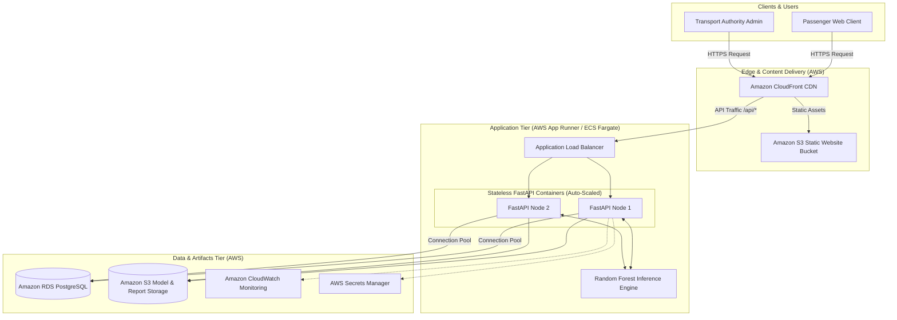
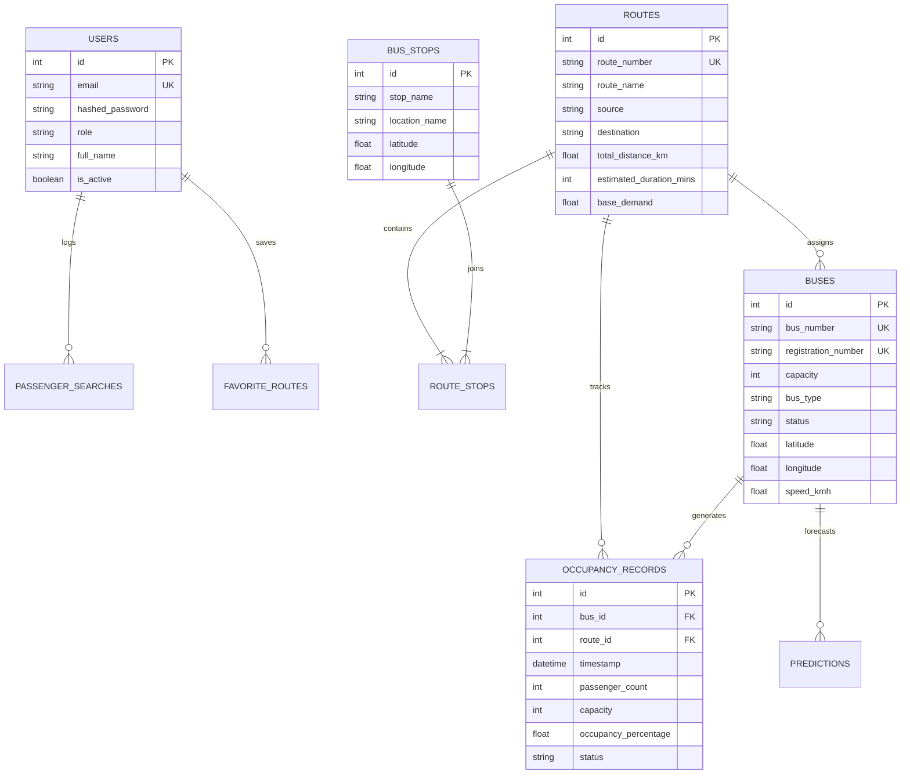

# SmartBus AI — System Architecture

**Cloud-Based Smart Public Bus Occupancy Prediction System**  
*Academic Cloud Computing Project | SDG 11: Sustainable Cities and Communities (Target 11.2)*

---

## 1. High-Level Architecture Overview

SmartBus AI is designed as a cloud-native, horizontally scalable 3-tier application:

---

## 2. Component Breakdown

### A. Frontend Tier (React.js + TypeScript + Vite + Tailwind CSS)
- **Deployment**: Deployed onto an Amazon S3 static website bucket fronted by Amazon CloudFront CDN.
- **Key Features**:
  - Dual login portal directly on the landing page for Passengers and Transport Authorities.
  - Interactive Leaflet + OpenStreetMap engine rendering Mysuru transit corridors, stops, and animated simulated vehicle telemetry.
  - Real-time bus search with AI-driven predicted passenger load, visual occupancy progress bars, and smart route alternative recommendations.
  - Comprehensive operations command center for fleet management, route assignment, ML test metrics inspection, and CSV report downloads.

### B. Backend Application Tier (FastAPI + Python 3.10)
- **Deployment**: Docker container deployed on AWS App Runner or AWS ECS (Fargate).
- **Core Modules**:
  - `app/api/auth.py`: JWT-based token generation and bcrypt password validation.
  - `app/api/buses.py` & `app/api/routes.py`: High-performance CRUD transit entity operations.
  - `app/api/occupancy.py`: Live vehicle occupancy telemetry with sensor drift simulation.
  - `app/api/predictions.py`: Direct inference with the pre-trained Random Forest model, finding least-crowded alternative buses.
  - `app/api/analytics.py`: Aggregate KPI calculations, peak-hour distributions, and route congestion rankings.
  - `app/api/reports.py`: High-throughput CSV file streaming.

### C. Machine Learning Engine (Scikit-Learn + Joblib)
- **Model**: `RandomForestRegressor(n_estimators=100, max_depth=16, random_state=42)`.
- **Target**: Continuous passenger count bounded non-negatively:
$$\text{Occupancy Rate (\%)} = \left(\frac{\text{Predicted Passengers}}{\text{Bus Seating Capacity}}\right) \times 100$$
- **Categorization Rule**:
  - `0% - 40%`: **LOW** (Green) — High seat availability
  - `41% - 70%`: **MODERATE** (Blue) — Normal transit load
  - `71% - 90%`: **HIGH** (Amber) — Standing room only
  - `91% - 100%`: **NEAR FULL** (Red) — Approaching vehicle limit
  - `> 100%`: **OVERCROWDED** (Dark Red) — Crush load, backup bus recommended

### D. Data Tier (PostgreSQL / SQLite Local Fallback)
- **Amazon RDS PostgreSQL**: Multi-AZ automated failover with read replicas.
- **Relational ER Schema**:

---

## 3. Scalability & Cloud Principles

1. **Stateless Compute**: Backend containers store zero session state in local memory. Authentication is stateless JWT verified using cryptographic signatures.
2. **Database Connection Pooling**: SQLAlchemy configured with `pool_size=15`, `max_overflow=25`, and `pool_pre_ping=True` to prevent connection exhaustion under heavy load.
3. **Decoupled Machine Learning**: Model artifacts are serialized via Joblib and loaded into memory on container startup, enabling sub-10ms inference per request without external API lag.
4. **Resilient Local Fallback**: Seamlessly functions with local SQLite (`sqlite:///./smartbus.db`) when cloud database instances are offline.
